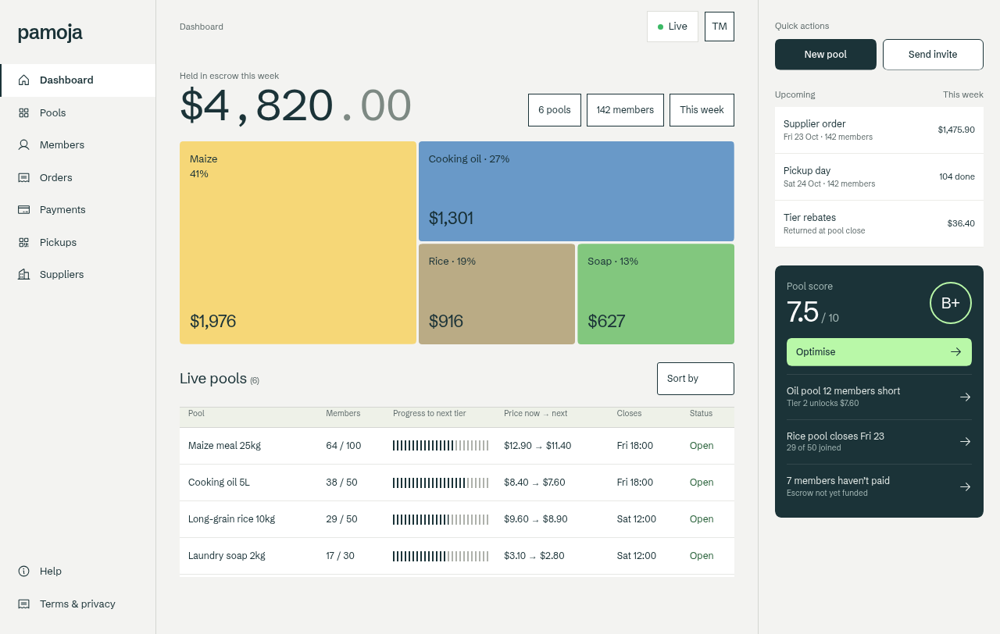

# Pamoja

A little each. A lot together. A runnable full-stack demo of community buying, from pooled demand and tier savings to supplier delivery and QR collection.

Built with **Next.js 16, TypeScript, Tailwind CSS 4, pnpm, Oxfmt, Oxlint, Phosphor Icons and Squircle.js**. Fonts are bundled locally. Data persists in SQLite using Node's built-in driver.



## Run

Use Node.js 24 LTS and pnpm 11.25.0 (declared in `packageManager`).

```sh
pnpm install --frozen-lockfile
pnpm dev
```

Open `http://localhost:3000`. A seeded workspace is created automatically. No service accounts or payment keys are needed.

The public introduction is at `/about`. Workspace screens remain at their existing routes.

```sh
pnpm check        # Formatting, lint, TypeScript and domain/storage tests
pnpm build       # Production build
pnpm start       # Run the production build
pnpm format      # Format with Oxfmt
```

Browser tests:

```sh
pnpm exec playwright install chromium
pnpm test:e2e
```

With an existing Chromium installation, set `PLAYWRIGHT_CHROMIUM_EXECUTABLE_PATH` to its executable path. CI builds and tests with Node.js 24.

For service-worker and offline-launch tests, stop any development server, run `pnpm build`, then `PWA_TESTS=1 pnpm test:e2e`. Playwright starts the production server. Development mode intentionally does not register a service worker.

## Brand, discovery and installation

Pamoja’s app icon is a sculpted mint community knot: three ribbons meeting around a shared centre. The wordmark, favicon, Apple touch icon, 192/512px app icons, maskable variants and social card share that direction. The [brand notes](docs/branding/README.md) describe the exports.

`/about` provides a server-rendered introduction, canonical metadata, Open Graph/Twitter previews and WebApplication structured data. `sitemap.xml` lists that public page. Workspace pages use `noindex`; robots rules exclude member, payment, order, invitation and pass routes, and APIs send `X-Robots-Tag`. These directives are discovery controls, not access control. `/llms.txt` describes the app and its demo/privacy boundaries; `/llm.txt` serves the same content for compatibility.

Set `NEXT_PUBLIC_SITE_URL` to the actual HTTPS production origin **before building**. The development fallback is `http://localhost:3000`. Canonical URLs, the sitemap, social metadata and LLM documentation all use this value.

Install Pamoja from the profile menu, Settings or the public introduction. Supporting browsers offer a native install prompt; other browsers receive home-screen instructions. The manifest includes safe-zone maskable icons, desktop/phone screenshots, stable app identity and Pools/Pickups shortcuts. Updates wait for “Update & reload” or until all older app windows close, so a new worker does not interrupt a payment or collection task.

System, Light and Dark appearance settings persist on the device and sync between tabs. The document canvas, member pages, loading/error screens, browser theme color and offline screen share the same background. A theme-specific manifest matches installation colors to the selected appearance. Installed launch-screen metadata can refresh on a browser/OS schedule; an installed splash screen cannot be recolored instantly by page JavaScript. Safe-area padding and dynamic viewport sizing accommodate notches, home indicators and mobile keyboards. Supported devices keep the camera awake while scanning; invite sharing uses the native share sheet with a clipboard fallback.

The production service worker caches a public offline page and static resources. Navigation stays network-first, with a branded fallback if the network fails. Workspace HTML, API responses, invite URLs, payment data and signed pickup passes are never written to its caches. Reopening offline shows the fallback; it does not restore a private workspace or enable offline payments/verification. Existing open collection screens retain their offline scan queue. Push notifications and automatic background financial actions are not implemented.

## Try the whole journey

| Audience | Route                           | What works                                                                        |
| -------- | ------------------------------- | --------------------------------------------------------------------------------- |
| Leader   | `/`                             | Escrow totals, demand treemap, pool progress, activity and invitations            |
| Leader   | `/pools`, `/pools/maize`        | Search, filters, creation, tiers, close, cancel/refund and funded order placement |
| Leader   | `/members`, `/payments`         | Membership search, escrow ledger, rebates, pagination and CSV export              |
| Leader   | `/orders`, `/pickups`           | Delivery handoff, signed QR verification, item checks and one-time collection     |
| Supplier | `/supplier`                     | Funded orders, line-item invoices, delivery slots and fee/payout breakdown        |
| Driver   | `/supplier/delivery/order-1042` | Load checklist, leader QR handoff and payout receipt                              |
| Member   | `/join/maize`                   | Quantity, consent, price tiers, demo payment slider and a pickup pass             |
| Member   | `/pass/:membershipId`           | Signed QR, expiry/refresh, download, tier progress and sharing                    |
| Leader   | `/settings`, `/suppliers`       | Persisted community details and supplier directory                                |

Start at `/join/maize`. Choose a quantity, continue, enter the pickup name, then slide to pay. On `/pools/maize`, open **Status: Open** and choose **Close & lock price**. Review and place the wholesale order. Confirm stock and a slot in the supplier console, check the driver's load, then scan or paste the leader's handoff QR to confirm delivery. In Pickups, scan the member's pass, check every line, and release the goods once.

The sample includes a closed rice batch ready to order, a maize pickup list with 104 of 142 collected, and a three-item pickup bundle. In the pickup scanner, verify `pickup-member-109` using its signed pass from `/api/passes/pickup-member-109` to see the pictured Nomsa D. maize-and-oil collection.

The fourteen supplied artboards are preserved in [reference artboards](docs/reference-artboards/README.md). The default leader phone view is **Direction B · Ledger**. Open `/?style=glass` for **Direction A · Glass**; links within this direction preserve the choice. The profile menu and Settings also expose both directions, the supplier console and the member flow. Desktop dashboards retain the ledger layout.

Motion includes page and panel transitions, scroll reveals, rising tier bars, animated price changes, quantity feedback, slider tracking and return, live indicators, and brief payment/pickup celebrations. Reduced-motion preferences disable decorative motion; reduced-transparency preferences make glass cards opaque. Fonts are self-hosted.

## Decisions from the handoff

The original [developer handoff](docs/developer-handoff.md) is preserved. Implementation decisions resolve its open questions:

- **Brand:** Pamoja. Both supplied leader phone directions, ledger desktop dashboards and supplier screens, and glass member screens. The supplied colors, three fonts, treemap, stage strip, striped bars and mint CTAs are used. Squircle.js supplies smooth corners on controls, product tiles and glass cards.
- **Fee:** Suppliers pay 2.5%, rounded once to integer cents. A $1,475.90 invoice yields a $36.90 fee and $1,439.00 payout. Members pay no additional fee. Escrow does not incur a second fee.
- **Pricing:** Funded memberships unlock tiers; quantities determine order units. Pending payments do not raise member counts. At close, earlier members receive `(price paid − final price) × quantity` as a simulated rebate.
- **Minimum:** The lowest tier must be funded before closing. A pool below the minimum can remain open or be cancelled for a full simulated refund. Cancellation is available before ordering.
- **Release:** Supplier payout is released once at verified drop-off. Member pickup releases goods; it never releases the same money a second time.
- **Market:** USD and the sample mobile-money/card options are retained. Market-specific currency and payment rails need a provider-backed implementation.
- **Surface:** All three roles use responsive web screens, consistent with the requested Next.js stack. A React Native application is outside this repository.

The uploaded photos now supply the visual references, including their artboard labels. [Design QA](design-qa.md) maps every artboard to an implementation capture. The illustrated order/fee figures conflict across screens; the working review uses the selected pool's actual funded amounts, one supplier fee, and rebates returned at close. The member payment text says funds are held until supplier delivery, consistent with the supplier handoff. QR images encode real signed tokens, so their patterns differ from the illustrative QR drawings.

## Data, updates and boundaries

Each browser receives an HttpOnly, SameSite demo-session cookie and an isolated, persisted sample workspace. Invite links intentionally share that sample workspace across browsers, including its role previews. They expire after seven days. This is a demonstration access model; it does not provide production authentication or role authorization.

SQLite uses WAL mode, parameterized queries and transactions. Mutations require an idempotency key. Failed mutations roll back. QR tokens use HMAC signatures, bind the workspace and handoff purpose, expire after 30 minutes and are verified on the server. Repeated pickups and delivery confirmations cannot release goods or payouts twice. A bundled pickup verifies all its memberships before releasing any goods, then marks all lines collected in one transaction.

Scans made in an already open collection screen can queue offline in browser storage. Goods remain unreleased until online verification and an explicit item-release action. Camera scanning uses `BarcodeDetector` where supported, with token entry and sample passes as fallbacks. The offline launch fallback is available after a successful first visit to the production app.

The app refreshes actual workspace data every 10 seconds and on reconnect/tab focus. Set `NEXT_PUBLIC_SIGNALR_URL` to an existing compatible hub to also invalidate data on the five handoff events. The hub must handle authentication and group membership; an ASP.NET SignalR server is not included. Polling continues when the hub is unavailable.

Copy `.env.example` to `.env.local` for optional configuration. `PAMOJA_DATA_DIR` selects the persistent directory. A QR-signing secret is generated and stored in SQLite automatically; `PAMOJA_QR_SECRET` can override it with a stable secret of at least 32 characters. Keep `.data/` and `.env.local` out of Git.

Run this SQLite demo on one Node server with a persistent disk. An ephemeral serverless filesystem will lose workspace data. Before handling real users or funds, add production identity/roles, a durable shared database and immutable financial ledger, a licensed payment partner and verified webhooks, a settlement worker, and the market's agreed refund/currency policies. The current payment adapter simulates state transitions and never moves money.

## Code map

```text
src/app/                    Next.js routes, local fonts and Tailwind theme
src/components/             Leader, member, supplier and delivery screens
src/lib/domain.ts           Pool, payment, order and pickup state transitions
src/lib/money.ts            Integer-cent pricing, fees and rebates
src/lib/store.ts            Transactional SQLite, sessions, invites and QR signatures
src/app/api/[[...path]]/     Validated REST API
tests/                      Domain/storage tests and complete browser journeys
src/components/design.tsx   Shared artboard primitives, direction and motion
src/app/reference.css       Measured reference layouts and responsive styles
docs/                       Handoff, source artboards, verification and captures
```

API details and invariants are in [architecture](docs/architecture.md).

Recreate the fourteen reference captures, dark preview and PWA install screenshots against a running server:

```sh
node scripts/capture-design.mjs
```

`PAMOJA_BASE_URL` changes the target server. `PLAYWRIGHT_CHROMIUM_EXECUTABLE_PATH` selects a browser; otherwise the script uses `/usr/bin/chromium`. Captures wait for session hydration, use reduced motion for stable stills, and exercise real payment, bundle verification and delivery-load transitions.
